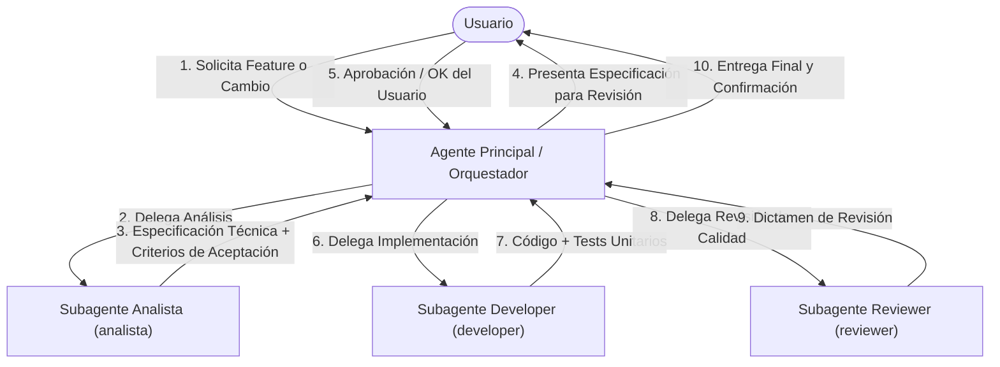

# AGENTS.md - Sistema de Gestión y Orquestación del Proyecto

Este documento define la arquitectura de agentes, las reglas de colaboración, los estándares de desarrollo y los protocolos operativos que rigen la administración de todo el proyecto en Google Antigravity / Gemini.

---

## 1. Estructura del Proyecto

El repositorio está organizado como un monorepo modular:

```text
mio/
├── AGENTS.md                  # Archivo raíz de gobernanza y reglas para los agentes
├── .agents/                   # Configuración del entorno Antigravity / Gemini
│   ├── agents/                # Definiciones de subagentes especializados
│   │   ├── analista.md        # Subagente Analista (Requerimientos y Arquitectura)
│   │   ├── developer.md       # Subagente Developer (Flutter Frontend & Python Backend)
│   │   └── reviewer.md        # Subagente Reviewer (Code Review & QA)
│   └── skills/                # Habilidades y runbooks especializados por flujo
│       └── README.md          # Guía y plantilla para agregar nuevas skills
├── frontend/                  # Aplicación Frontend en Flutter (Dart)
└── backend/                   # Servicio Backend en Python (FastAPI / APIs)
```

---

## 2. Roles, Modelos y Matriz de Responsabilidades

| Agente / Subagente | Modelo Asignado | Rol Principal | Herramientas & Ámbitos | Responsabilidades Clave |
| :--- | :---: | :--- | :--- | :--- |
| **Agente Principal (Orquestador)** | *Sesión activa* | Coordinador General | Todo el workspace, chat con usuario, delegación de subagentes | - Interpreta las solicitudes del usuario.<br>- Orquesta el flujo de trabajo entre subagentes.<br>- Consolida entregables finales y reporta avances. |
| **`analista`** (Subagente) | **`pro`** | Requerimientos & Arquitectura | `.agents/agents/analista.md` | - Razonamiento profundo de arquitectura.<br>- Define contratos de API y modelos de datos.<br>- Redacta criterios de aceptación verificables.<br>- Desglosa tareas en pasos atómicos. |
| **`developer`** (Subagente) | **`pro`** | Desarrollo Full-Stack | `frontend/`, `backend/`, tests | - Implementa interfaces y lógica en Flutter.<br>- Desarrolla endpoints, servicios y lógica en Python.<br>- Escribe pruebas unitarias e integración.<br>- Resuelve bugs y refactoriza código. |
| **`reviewer`** (Subagente) | **`flash`** | Auditoría de Código & QA | Lectura de código, linters, tests | - Auditoría rápida y eficiente de criterios.<br>- Valida linters y ejecución de suites de pruebas.<br>- Dictamen ágil: Aprobado / Cambios Requeridos.<br>*(Puede cambiarse a `pro` para auditorías críticas de seguridad)*. |

---

## 3. Ciclo de Vida de Desarrollo (Workflow)

Toda nueva funcionalidad, módulo o refactorización significativa debe seguir el siguiente flujo estandarizado:



1. **Fase 1: Análisis**:
   - El Agente Principal invoca a `analista` con la descripción del requerimiento.
   - El Analista produce la especificación técnica, contratos JSON/Pydantic y los criterios de aceptación.
2. **Fase 2: Revisión y Aprobación del Usuario (Checkpoint Obligatorio)**:
   - El Agente Principal presenta la propuesta y especificación técnica al Usuario.
   - El Usuario revisa, realiza observaciones o da su **OK** explícito.
   - **Regla estricta**: No se delega trabajo al `developer` hasta contar con el OK del Usuario.
3. **Fase 3: Implementación**:
   - Con el OK del Usuario, el Agente Principal delega la tarea a `developer` con la especificación aprobada.
   - El Developer escribe el código en `frontend/` y/o `backend/`, asegurando pruebas básicas y tipado estricto.
4. **Fase 4: Revisión de Calidad (QA)**:
   - El Agente Principal envía el código y la especificación a `reviewer`.
   - El Reviewer audita el cumplimiento de criterios, estándares y seguridad.
   - Si se requieren cambios, se regresa al Developer; si se aprueba, se procede al cierre.
5. **Fase 5: Consolidación y Entrega**:
   - El Agente Principal presenta el resultado validado al usuario.

---

## 4. Reglas Técnicas por Directorio

### 4.1. Frontend (`frontend/` - Flutter)
- **Lenguaje y SDK**: Dart & Flutter SDK moderno.
- **Arquitectura**: Arquitectura limpia con separación estricta:
  - `lib/core/` (utilidades, constantes, cliente HTTP base, temas).
  - `lib/features/<nombre_feature>/` (presentation, domain, data).
- **Manejo de Estado**: Unificado y predecible (BLoC, Riverpod o Provider).
- **Gestión de Recursos**: Siempre cancelar suscripciones (`StreamSubscription`), controladores (`TextEditingController`, `ScrollController`) y animaciones en el método `dispose()`.
- **Calidad de Código**: Todo el código debe pasar `flutter analyze` sin warnings críticos.

### 4.2. Backend (`backend/` - Python)
- **Versión**: Python 3.10+ con tipado estático estricto (`typing`, Pydantic).
- **Framework Recomendado**: FastAPI (APIs REST asíncronas con documentación OpenAPI automática).
- **Arquitectura Obligatoria en Capas**:
  - `app/api/` (**Resource / Routers**): Adaptadores delgados de entrada HTTP, enrutamiento, validación con Schemas, inyección de dependencias (`Depends`), status codes. **PROHIBIDO contener lógica de negocio o queries a la base de datos**.
  - `app/services/` (**Services / Negocio**): Orquestación pura de casos de uso, reglas de negocio, validaciones complejas, mock auth fallbacks. **PROHIBIDO llamar directamente a clientes de base de datos o Supabase** (debe consumir la capa de repositorios).
  - `app/repositories/` (**Repositories / Persistencia**): Única capa autorizada para interactuar con bases de datos (Supabase client, queries `.table()`, `.storage`). Retorna entidades de dominio (`models/`).
  - `app/models/` (**Domain Models**): Entidades de dominio y representación de base de datos (`UserModel`, `ProfileModel`), desacopladas del protocolo HTTP.
  - `app/schemas/` (**Schemas / DTOs**): Modelos Pydantic para serialización y validación estricta de Request y Response HTTP.
  - `app/utils/` (**Utils / Transversal**): Funciones utilitarias reutilizables sin estado (validación de archivos y tipos MIME, generadores de rutas de storage, formateo). Toda lógica repetitiva debe extraerse aquí.
  - `app/core/` (configuración con variables de entorno, seguridad JWT, clientes base).
- **Seguridad**:
  - Prohibido versionar credenciales o claves API; usar variables de entorno con archivos `.env` (excluidos en `.gitignore`).
  - Validación rigurosa de todas las entradas del usuario.
  - Manejo adecuado de excepciones mediante `HTTPException` con códigos de estado semánticos (400, 401, 403, 404, 500).
- **Pruebas**: Cobertura de tests unitarios y de endpoints usando `pytest` y `httpx`.

### 4.3. Configuración de Agentes y Modelos (`.agents/agents/`)
- Contiene los archivos de definición y roles de los subagentes en `.agents/agents/`.
- Cada agente tiene configurado en su frontmatter YAML (`model: pro | flash | flash_lite | inherit`) el modelo asignado para maximizar eficiencia de costo, velocidad y profundidad de razonamiento.
- No alterar la estructura de frontmatter YAML de los agentes para preservar el descubrimiento automático de Antigravity.

### 4.4. Habilidades y Procedimientos (`.agents/skills/`)
- Cada habilidad se almacena en su propio directorio: `.agents/skills/<nombre-skill>/SKILL.md`.
- Emplea **Progressive Disclosure**: Antigravity solo inyecta el nombre y descripción en el prompt del sistema y carga el contenido completo únicamente al invocarse la habilidad.
- Consultar `.agents/skills/README.md` para ver la plantilla de creación de nuevas skills.

---

## 5. Protocolo de Comunicación entre Agentes

- Los agentes deben comunicarse con claridad técnica, evitando ambigüedades.
- Toda referencia a archivos debe usar rutas relativas al proyecto (ej. `frontend/lib/...` o `backend/app/...`).
- El Developer nunca debe modificar unilateralmente un contrato de datos sin antes coordinar con el Analista.
- El Reviewer debe acompañar cualquier señalamiento con un ejemplo o sugerencia concreta de solución.
