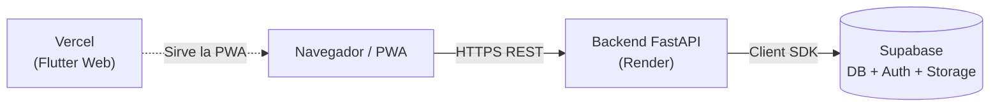

# Guía de Despliegue: Backend en Render + Frontend en Vercel + Supabase

Arquitectura objetivo:



- **Supabase**: DB, Auth y Storage (fuera de este repo).
- **Backend (`backend/`)**: Docker en **Render** vía [`render.yaml`](../render.yaml) + [`backend/Dockerfile`](../backend/Dockerfile).
- **Frontend (`frontend/`)**: Flutter Web PWA en **Vercel** vía [`frontend/vercel.json`](../frontend/vercel.json) + [`frontend/scripts/vercel_build.sh`](../frontend/scripts/vercel_build.sh).

Las variables de entorno **no se versionan**: se cargan en el panel de Render y en el panel de Vercel.

---

## Orden recomendado

1. Desplegar el **backend en Render** y copiar su URL pública.
2. Desplegar el **frontend en Vercel** con `API_BASE_URL` = URL del backend.
3. Volver a Render y setear `BACKEND_CORS_ORIGINS` con la URL del frontend en Vercel.

---

## 1. Backend en Render

### Archivos listos

| Archivo | Rol |
| --- | --- |
| [`render.yaml`](../render.yaml) | Blueprint: Docker, healthcheck `/api/v1/health`, env keys |
| [`backend/Dockerfile`](../backend/Dockerfile) | Imagen `python:3.11-slim`, usuario no privilegiado, `uvicorn` en `$PORT` |
| [`backend/.env.example`](../backend/.env.example) | Referencia de keys (sin secretos) |

### Pasos

1. Conectar el repositorio en [Render](https://render.com) → **New +** → **Blueprint** (usa `render.yaml`) o **Web Service** con:
   - Root / Docker context: `backend`
   - Dockerfile: `backend/Dockerfile`
2. En **Environment** del servicio, cargar (valores reales solo en el panel):

| Variable | Dónde | Notas |
| --- | --- | --- |
| `SUPABASE_URL` | Panel | Project URL de Supabase |
| `SUPABASE_KEY` | Panel | Anon/public key |
| `SUPABASE_SERVICE_ROLE_KEY` | Panel | Service role (solo backend) |
| `SUPABASE_JWT_SECRET` | Panel | JWT secret del proyecto |
| `BACKEND_CORS_ORIGINS` | Panel | URL del FE en Vercel, ej. `https://mio-app.vercel.app` (después del paso 2) |
| `SUPABASE_AVATARS_BUCKET` | Blueprint default `profiles` | Debe coincidir con el bucket real |
| `USE_MOCK_AUTH` | Blueprint default `false` | No activar en producción |
| `BACKEND_CORS_ORIGIN_REGEX` | Blueprint | Ya incluye `*.vercel.app` + localhost |
| `PORT` / `ENVIRONMENT` | Blueprint | `8000` / `production` |

3. Verificar: `https://<servicio>.onrender.com/api/v1/health`

> En el plan free de Render el servicio duerme tras ~15 min. La primera request puede tardar ~30 s.

---

## 2. Frontend en Vercel

### Archivos listos

| Archivo | Rol |
| --- | --- |
| [`frontend/vercel.json`](../frontend/vercel.json) | Build Flutter, output `build/web`, SPA rewrites, cache PWA |
| [`frontend/scripts/vercel_build.sh`](../frontend/scripts/vercel_build.sh) | Instala Flutter stable y compila con `API_BASE_URL` |
| [`frontend/lib/core/constants/api_endpoints.dart`](../frontend/lib/core/constants/api_endpoints.dart) | Lee `API_BASE_URL` en compile-time |

### Pasos

1. En [Vercel](https://vercel.com) → **Add New Project** → mismo repo.
2. Settings del proyecto:
   - **Root Directory**: `frontend`
   - Framework Preset: **Other** (lo define `vercel.json`)
3. En **Environment Variables** del proyecto Vercel:

| Variable | Valor | Entornos |
| --- | --- | --- |
| `API_BASE_URL` | `https://<servicio>.onrender.com` | Production (y Preview si querés apuntar al mismo BE) |

Sin `API_BASE_URL` el build **falla a propósito** para no publicar la app apuntando a `127.0.0.1`.

4. Deploy. La URL queda tipo `https://<proyecto>.vercel.app`.
5. Volvé a Render y setea `BACKEND_CORS_ORIGINS` con esa URL (sin barra final). Redeploy del backend o “Manual Deploy” si hace falta.

### Build local equivalente

```powershell
cd frontend
flutter build web --release --dart-define=API_BASE_URL=https://mio-backend.onrender.com
```

---

## 3. Instalar la PWA en el celular

1. Abrí la URL de Vercel en el navegador del teléfono.
2. **Android (Chrome)**: menú `⋮` → Instalar aplicación / Agregar a la pantalla principal.
3. **iOS (Safari)**: Compartir → Agregar a inicio.

---

## 4. Desarrollo local

```powershell
# Backend
cd backend
# Copiar .env.example → .env y completar keys locales
uvicorn app.main:app --reload --host 127.0.0.1 --port 8000

# Frontend (default API_BASE_URL = http://127.0.0.1:8000)
cd frontend
flutter run -d chrome --web-port=3000

# Frontend apuntando al BE en Render
flutter run -d chrome --web-port=3000 --dart-define=API_BASE_URL=https://mio-backend.onrender.com
```
