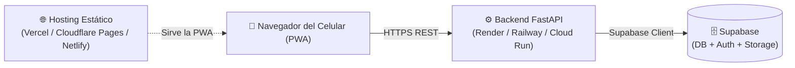

# Guía de Despliegue y Uso: Backend FastAPI + Flutter Web PWA + Supabase

Este documento describe cómo desplegar el **Backend (FastAPI)** y el **Frontend (Flutter Web como PWA)** en la nube conectados a **Supabase**, y cómo instalar y usar la aplicación desde el navegador del celular.

---

## 1. Arquitectura de Despliegue



- **Base de Datos, Auth y Storage**: Alojados en **Supabase**.
- **Backend (`backend/`)**: Servicio web en Python/FastAPI contenedorizado con [`backend/Dockerfile`](../backend/Dockerfile) y [`render.yaml`](../render.yaml).
- **Frontend (`frontend/`)**: Progressive Web App (PWA) compilada con Flutter Web (`frontend/build/web`) lista para alojarse en cualquier CDN estático con HTTPS (Vercel, Cloudflare Pages, Firebase Hosting o Netlify).

---

## 2.Archivos de Configuración Incluidos en el Proyecto

### Backend (`backend/`)
- **[`backend/app/core/config.py`](../backend/app/core/config.py)** y **[`backend/app/main.py`](../backend/app/main.py)**:
  - Soporta `BACKEND_CORS_ORIGINS` como lista JSON (`["https://mio-app.vercel.app"]`) o texto separado por comas (`https://mio-app.vercel.app,http://localhost:3000`).
  - Limpia automáticamente barras finales (`/`) y excluye el comodín `"*"` para mantener compatibilidad con `allow_credentials=True`.
  - Soporta `BACKEND_CORS_ORIGIN_REGEX` para habilitar dominios dinámicos (por ejemplo, previews de Vercel o Cloudflare).
- **[`backend/Dockerfile`](../backend/Dockerfile)** y **[`backend/.dockerignore`](../backend/.dockerignore)**:
  - Imagen liviana `python:3.11-slim` con usuario sin privilegios (`appuser`), healthcheck automático en `/api/v1/health` y arranque con `uvicorn` tomando la variable `$PORT`.
- **[`render.yaml`](../render.yaml)**:
  - Blueprint declarativo en la raíz del repositorio para desplegar el servicio en Render.

### Frontend (`frontend/`)
- **[`frontend/lib/core/constants/api_endpoints.dart`](../frontend/lib/core/constants/api_endpoints.dart)**:
  - Lee la URL del backend en tiempo de compilación mediante `--dart-define=API_BASE_URL=...` (con fallback automático a `http://127.0.0.1:8000` para desarrollo local) y normaliza barras finales.
- **[`frontend/web/manifest.json`](../frontend/web/manifest.json)** y **[`frontend/web/index.html`](../frontend/web/index.html)**:
  - Configurados con `"display": "standalone"`, `"orientation": "portrait-primary"`, colores `#1E88E5` / `#F5F7FB`, iconos `192x192` y `512x512`, meta-tags para iOS/Safari (`apple-mobile-web-app-capable`) y pantalla de carga inicial.
- **[`frontend/vercel.json`](../frontend/vercel.json)** y **[`frontend/web/_redirects`](../frontend/web/_redirects)**:
  - Reglas de reescritura SPA (`/(.*) -> /index.html`) y cabeceras de caché óptimas para el Service Worker de la PWA.

---

## 3. Paso a Paso para Desplegar

### Paso 1: Desplegar el Backend en Render (o Railway / Cloud Run)

1. Sube tus cambios al repositorio de GitHub.
2. Ingresa a [Render.com](https://render.com) → **New +** → **Blueprint** (detectará el archivo [`render.yaml`](../render.yaml) de la raíz) o crea un **Web Service** apuntando a tu repositorio.
3. En la sección **Environment Variables** del servicio en Render, configura las credenciales que usas en tu `.env` local:
   - `SUPABASE_URL`: URL de tu proyecto en Supabase.
   - `SUPABASE_KEY`: Anon/Public key de Supabase.
   - `SUPABASE_SERVICE_ROLE_KEY`: Service Role key de Supabase.
   - `SUPABASE_JWT_SECRET`: JWT Secret de tu proyecto en Supabase.
   - `SUPABASE_AVATARS_BUCKET`: `profiles`
   - `USE_MOCK_AUTH`: `false`
   - `BACKEND_CORS_ORIGINS`: URL pública donde alojarás la PWA (ej. `https://mio-training.vercel.app`).
   - `BACKEND_CORS_ORIGIN_REGEX`: `^https://.*\.vercel\.app$` *(opcional, recomendado si usas Vercel para permitir cualquier URL de preview).*
4. Una vez finalizado el despliegue, copia la URL pública de tu backend (ej. `https://mio-backend.onrender.com`) y verifica que responda abriendo `https://mio-backend.onrender.com/api/v1/health`.

> [!NOTE]
> En el plan gratuito de Render, el contenedor entra en reposo tras 15 minutos sin actividad y la primera petición puede demorar ~30 segundos en despertar. Si deseas evitar ese arranque en frío, puedes configurar un monitor gratuito (como UptimeRobot o Cron-job.org) que consulte `/api/v1/health` cada 10–14 minutos, o desplegar el mismo `backend/Dockerfile` en **Google Cloud Run** / **Railway**.

---

### Paso 2: Compilar y Publicar la PWA de Flutter

1. Abre una terminal en `C:\Aplicaciones\mio\frontend` y compila la versión de producción inyectando la URL de tu backend:
   ```powershell
   flutter build web --release --dart-define=API_BASE_URL=https://mio-backend.onrender.com
   ```
   Esto generará la carpeta estática lista para producción en `frontend/build/web`.

2. Publica el contenido de `frontend/build/web` en tu hosting estático preferido:

   - **Opción A — Vercel CLI (Rápida desde terminal)**:
     ```powershell
     Copy-Item vercel.json build/web/vercel.json
     npx vercel deploy build/web --prod
     ```
   - **Opción B — Cloudflare Pages / Netlify (Drag & Drop)**:
     1. Entra al panel de **Cloudflare Pages** o **Netlify**.
     2. Elige subir carpeta manualmente (*Upload assets* / *Deploy manually*).
     3. Arrastra la carpeta `frontend/build/web` (que ya incluye el archivo `_redirects`).

3. Copia la URL `https://...` generada por Vercel/Cloudflare y asegúrate de que esté agregada en la variable `BACKEND_CORS_ORIGINS` de tu backend en Render.

---

### Paso 3: Instalar y Usar la PWA en el Celular

1. Abre la URL `https://...` de tu PWA desde el navegador de tu teléfono:
   - **En Android (Google Chrome)**:
     1. Toca el menú de tres puntos `⋮` (esquina superior derecha).
     2. Selecciona **"Instalar aplicación"** o **"Agregar a la pantalla principal"**.
   - **En iPhone / iOS (Safari)**:
     1. Toca el botón **Compartir** (ícono cuadrado con flecha hacia arriba en la barra inferior).
     2. Desliza hacia abajo y selecciona **"Agregar a inicio"** (*Add to Home Screen*).
     3. Toca **"Agregar"** arriba a la derecha.
2. Verás el ícono de **Mio Training** en la pantalla de inicio de tu celular y, al abrirlo, se ejecutará a pantalla completa (`standalone`) como una aplicación nativa sin las barras del navegador.

---

## 4. Comandos Útiles para Desarrollo Local

- **Ejecutar en navegador local apuntando al backend local (`127.0.0.1:8000`)**:
  ```powershell
  cd frontend
  flutter run -d chrome
  ```
- **Ejecutar en navegador local apuntando al backend en la nube**:
  ```powershell
  cd frontend
  flutter run -d chrome --dart-define=API_BASE_URL=https://mio-backend.onrender.com
  ```
